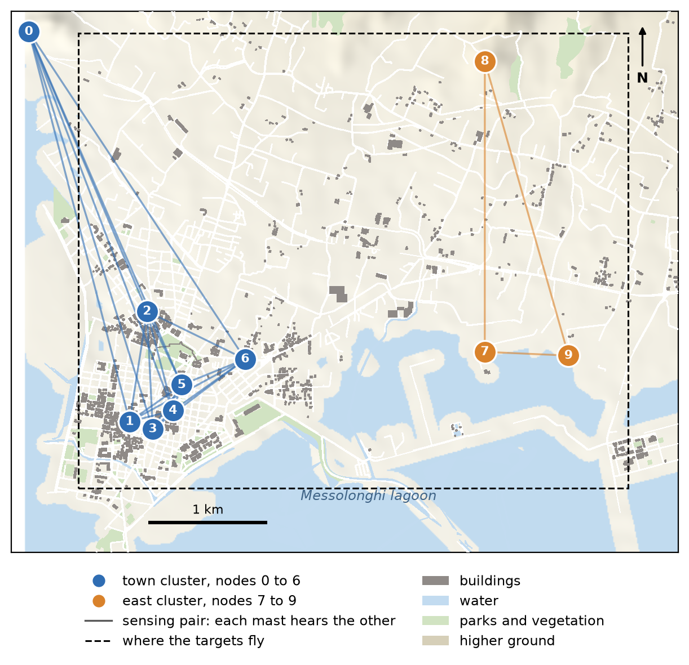
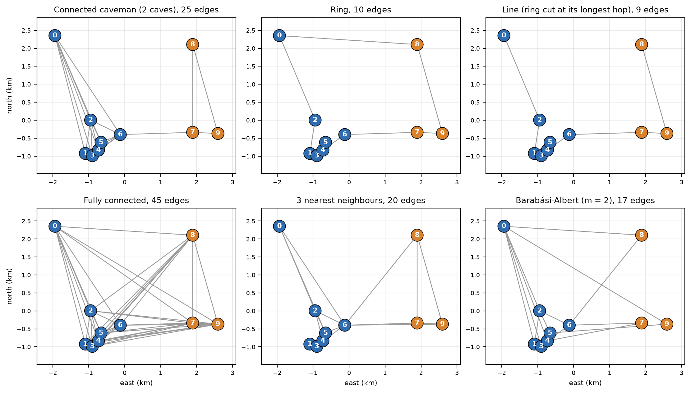
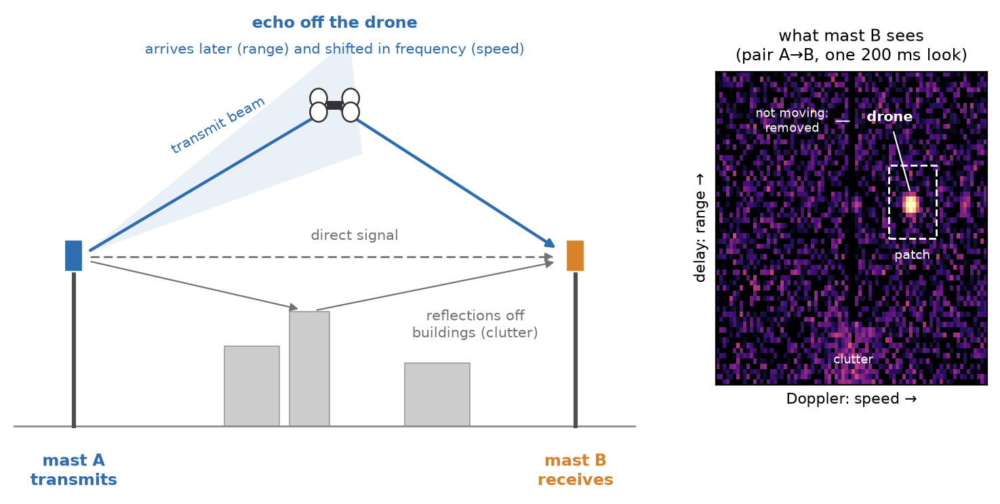
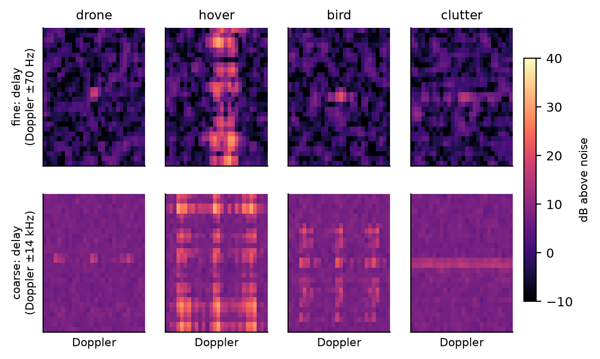
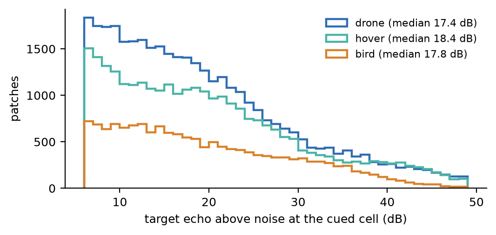
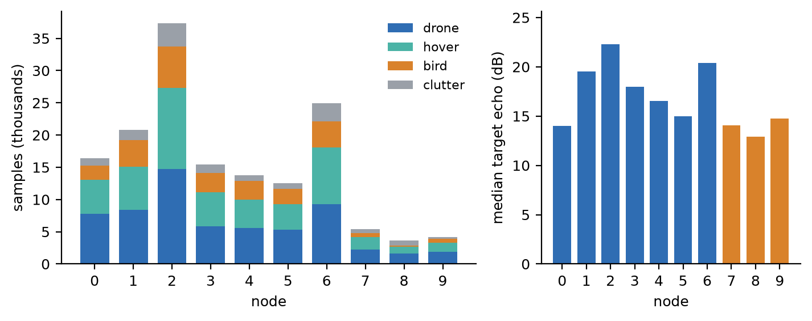

# Messolonghi ISAC Dataset

**Range-Doppler dataset for decentralized and federated learning over 10 real masts**

ISAC digital twin · 26 Oct 2026

Ten licensed mobile masts in Messolonghi, each one a learning node. Every node keeps its own labelled radar patches (drone, hovering drone, bird, clutter) from bistatic ISAC sensing, simulated by ray tracing on a 3D model of the town.

| 154,576 | 10 nodes | 3.7k to 37k | ~18 dB |
|:---:|:---:|:---:|:---:|
| labelled 28×28 patches | real masts, 2 clusters | samples per node | median target echo |

## What it is

The 10 nodes are the 10 licensed mobile masts of Messolonghi, Greece, at their real positions, from the public antenna registry. They form two geographic clusters ("caves"): the town (nodes 0 to 6) and the east (nodes 7 to 9). Inside a cave every ordered pair of masts is a bistatic sensing pair, 48 pairs in all.

Each run has one target flying anywhere over the masts' area (4.6 km × 3.8 km). Every look (200 ms), each receiving node stores patches around its detections, plus one patch cued at the true target cell when the target's own echo there is at least 6 dB above the noise. The data is non-IID by geometry and hardware, not by an artificial split.

*The 10 masts over Messolonghi. Blue: the town cluster (nodes 0 to 6). Orange: the east cluster (nodes 7 to 9). A line joins two masts that sense together: each one receives the other's signal reflected by the target. Targets fly inside the dashed box. Masts of different clusters do not sense together. The communication graphs below link the clusters for learning. Node 0 stands at the edge of the 3D model, 3 km from the rest of its cluster: an uninformative node, kept on purpose. Map data © OpenStreetMap contributors (ODbL), terrain SRTM.*

Five masts have a recent public licence study (radio-emission study, 2023 to 2025) that lists their 3.5 GHz antennas: height, sector azimuths, gain, beamwidths and power per sector. These are nodes 2, 5, 6, 8 and 9. For the other five the latest documents are older 3G studies (2013 to 2018) without 3.5 GHz antennas, a declaration without an antenna table, or none at all, so they use a generic sensing panel (18 dBi, 64° × 6.5°) in 3 sectors, at 20 m and 8 W.

## Communication graphs

*Six candidate graphs in `graphs.json`, all connected: caveman (2 caves, one bridge), ring, line, fully connected, 3 nearest neighbours, and Barabási-Albert (m = 2, seed 0).*

## How the masts sense

*One sensing pair. Mast B receives the direct signal from mast A, reflections off buildings and ground, and the echo off the drone. The echo arrives later than the direct signal, which gives its range, and its frequency is shifted by the drone's motion, which gives its speed. Over one look mast B builds a range-Doppler map. What does not move is removed, so the drone stands out, and a patch is cut around it.*

1. **Every mast transmits.** Each mast sends a 5G signal at 3.5 GHz on its own tenth of the 100 MHz band (9.8 MHz), so the ten signals do not overlap.
2. **The other masts of the cluster receive.** Each ordered pair of masts in a cluster, one transmitting and one receiving, works as a radar: 48 pairs in all.
3. **One look lasts 200 ms.** Over a look the receiver measures the echo's delay, in range steps of 30.6 m, and its Doppler shift, in steps of 5 Hz (the echo path changing by about 0.4 m every second).
4. **What does not move is removed.** The direct signal, buildings and ground have no Doppler shift and are cancelled. A hovering drone still shows once its drift reaches one Doppler step, and its rotors add lines on both sides of it.
5. **A detector marks what stands out.** A cell is a detection when it is clearly above its neighbours (CFAR) and above the usual clutter level at that cell (clutter map). The receiving node stores a 28 × 28 patch around each detection, plus one patch at the target's true cell when its echo there is at least 6 dB above the noise (the cued patch).
6. **Beams search, then track.** Each mast has one steerable transmit beam: one of its 3 sectors and one of 6 elevations from 1° to 21°. Without a target the beam sweeps. Once any pair of a cluster detects the target, all masts of that cluster point at it (with a 30 / 30 / 10 m position error), and they search again after 5 looks without a detection. Receivers form all their beams digitally and keep the best one toward the target.
7. **Simulator.** Sionna RT 2.2 ray tracing on a 3D model of the town. Every look is also computed without clutter and noise, which gives the target's own echo strength (`tgt_snr_db`).

## Classes

| y | class | model |
|---|---|---|
| 0 | drone | 3GPP small UAV, 5-15 m/s, 30-150 m altitude, rotor micro-Doppler |
| 1 | hover | same drone holding station (drift 0.3-1 m/s), 30-120 m. Body 1-3 bins from zero Doppler (median 10 Hz), so the rotor spread is what tells it apart |
| 2 | bird | 8-15 m/s, 20-120 m, RCS −30 to −16 dBsm, wings flapping ±40° at 3-8 Hz |
| 3 | clutter | any detection not on the target, up to 3 per pair and look. Mostly isolated noise and residual-clutter peaks far from zero Doppler (median 6 kHz) |

*One example per class from node 2, target patches picked near 20 dB echo. Top: the fine patch (28 delay bins × 28 Doppler bins of 5 Hz around the cell). Bottom: the coarse patch (the same delays × the whole ±14 kHz Doppler axis pooled to 28 bins), where the rotor and wing lines show.*

*Target echo at the cued cell, all nodes. The 6 dB gate sets the floor. p10 / median / p90: drone 8.1 / 17.4 / 35.4 dB, hover 8.0 / 18.4 / 37.7 dB, bird 8.2 / 17.8 / 34.2 dB.*

## Size and the per-node picture

| | |
|---|---:|
| samples | 154,576 |
| drone / hover / bird / clutter | 62,646 / 51,420 / 26,429 / 14,081 |
| cued target patches (echo ≥ 6 dB) | 81,344 |
| detections (target / clutter) | 59,151 / 14,081 |
| train / val / test (108 / 36 / 36 runs) | 95,505 / 31,035 / 28,036 |
| runs | 180 (60 per target class), 40 looks each |

*Left: samples per node by class. Right: median target echo per node (blue town, orange east). The class mix is similar everywhere, so the heterogeneity is in size, signal strength and clutter share.*

| node | cave | samples | drone / hover / bird / clutter % | cued | median echo |
|---:|---|---:|---|---:|---:|
| 0 | town | 16,385 | 47 / 33 / 13 / 7 | 10,341 | 14.0 dB |
| 1 | town | 20,833 | 40 / 32 / 20 / 8 | 10,849 | 19.5 dB |
| 2 | town | 37,326 | 40 / 34 / 17 / 10 | 17,387 | 22.3 dB |
| 3 | town | 15,479 | 38 / 34 / 19 / 9 | 7,584 | 17.9 dB |
| 4 | town | 13,807 | 41 / 32 / 21 / 7 | 7,724 | 16.5 dB |
| 5 | town | 12,552 | 42 / 31 / 19 / 7 | 7,334 | 15.0 dB |
| 6 | town | 24,902 | 37 / 35 / 16 / 11 | 11,713 | 20.4 dB |
| 7 | east | 5,395 | 41 / 37 / 11 / 11 | 3,464 | 14.0 dB |
| 8 | east | 3,688 | 43 / 29 / 6 / 22 | 2,294 | 12.9 dB |
| 9 | east | 4,209 | 44 / 34 / 13 / 8 | 2,654 | 14.7 dB |

## Files (folder `K10/`)

- `nodes/nodeXX.npz`, one per receiving node (111 MB in all): `fine` and `coarse` uint8 [n, 28, 28], pixel to dB is `dB = v/4 − 10` (above the median noise, −10 to 53.75). Also `y` [n], `split` [n] (train / val / test), `meta` float [n, 23] and `meta_names`.
- `graphs.json`: undirected edge lists of the six graphs above. Drawn in `graphs_K10.png`.
- `nodes.json`: position, cave, height, power, sector azimuths, antenna gain and beamwidths, documented flag, beam codebook and waveform parameters.
- `summary.json`: samples per node and class.

### Meta columns

`run, look, t_s, tx, rx, label, cued, target_detected, delay_bin, doppler_bin, doppler_hz, snr_db, bistatic_range_m, rx_target_range_m, tgt_x, tgt_y, tgt_z, tgt_snr_db, tracked, tx_sector, tx_el_deg, rx_sector, rx_el_deg`

`snr_db` is the patch centre over the noise, whatever is there. `tgt_snr_db` is the target's own echo at the cued cell (−100 for clutter rows). `tracked` means the transmitter's cave was in track mode.
